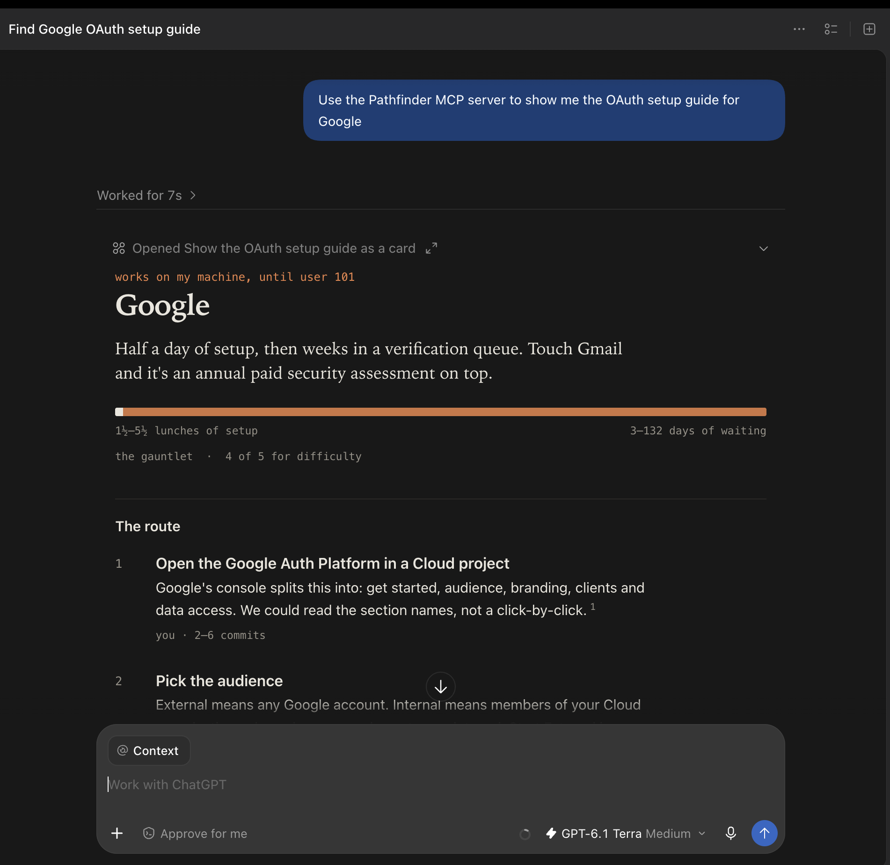

# path/finder — submission notes

**Live:** https://oauth-pathfinder-topaz.vercel.app
**Repo:** https://github.com/madanarnav2004/oauth-pathfinder
**MCP endpoint:** https://oauth-pathfinder-topaz.vercel.app/mcp

---

## The call I made

The brief asks for a working experience that tells a developer how hard an OAuth app will be, and lets an agent generate a guide for an app it hasn't seen.

I built that as **an MCP server first and a website second.**

The developer who needs this answer is already inside Claude Code, Codex or Cursor when the question comes up. Sending them to a documentation site is asking them to leave the place where the work is happening, read, translate, and come back. The better product puts the answer where the question was asked — and once an agent has the guide as structured data, it can act on it rather than just display it.

So the primary surface is five MCP tools. The website is the share target: a guide needs to be a link you can paste into a thread, and reviewers need somewhere to click.

## Try it in two minutes

```bash
claude mcp add --transport http pathfinder https://oauth-pathfinder-topaz.vercel.app/mcp
```

Then, in the agent:

1. **"how hard is it to get a Slack OAuth app approved?"** → the card draws in the conversation
2. **"what about Linear?"** → not in the library, so it researches live, about a minute
3. **"I'm getting bad_redirect_uri on Slack"** → cause and fix from the known failure modes
4. **"set it up for localhost:3000 and app.example.com"** → the exact redirect URIs, env var names, and which scopes are gated



Or on the website: the front page, then any of the eight guides, then type an app that isn't there.

## What a developer learns

Each guide opens with the answer in a sentence, then the numbers:

> **Google.** Half a day of setup, then weeks in a verification queue. Touch Gmail and it's an annual paid security assessment on top.

Setup time and waiting time are always separate, and drawn on one bar. For Google the setup is a sliver and the review is the rest — that ratio *is* the finding, and a single number would have hidden it.

Then the route, every step marked **you**, **an agent**, or **the provider by name**, so "who is blocking me" is answerable at a glance. Then what will bite you, who does what, what changes your plan, and what to do when it breaks.

## Evidence, which is the whole product

A setup guide you can't audit is worth nothing. Four statuses:

**sourced** (a page we fetched says so) · **we ran this** (we called the endpoint) · **our read** (nobody states it) · **not documented** (we looked and couldn't find out)

Two design decisions follow:

**Only the exceptions are badged.** Sourced is the baseline, so it carries a numbered citation and no badge. A badge always means "this one is different." Earlier drafts put a chip on every row; it looked rigorous and conveyed nothing.

**No invented timelines.** If no source states a wait, the guide says so and the bar runs off the edge. Most providers publish no review timeline, so most of the library has an undocumented wait. Saying "2–4 weeks" would be the single most useful-looking and most dishonest thing this product could do.

For live generation these are enforced by code, not asked of the model: an unquoted `sourced` claim is downgraded, a second model family re-checks each quote against its claim, only the probe module can mint `we ran this`, and unsourced durations are dropped.

## What I verified, and how

- **50 automated tests.** The interesting ones feed a deliberately lying model into the pipeline and assert its unsupported claims get downgraded, its invented wait disappears, and its fabricated endpoint never gets probed.
- **The card runs in a real host.** `npm run verify:card` starts the server, speaks MCP over HTTP, loads the card in a browser through the official MCP Apps `AppBridge`, completes the `ui/initialize` handshake, sends a real tool result, clicks both buttons and asserts the host receives the right `ui/message` and `ui/open-link`. Light and dark. Screenshots in `tests/host/shots/`.
- **All sixteen provider endpoints probed** with a dummy client. Every one answered; those responses are the `we ran this` claims.
- **Each guide checked against the provider's own docs.** `/how-we-checked` lists every correction.

Three corrections worth naming:

1. Search pointed me at a Google page for "verification requirements" that turns out to cover **only annual recertification**. Re-sourced.
2. Google's own docs contain the most useful sentence for most apps, which I'd have missed by skimming: ask only for `openid email profile` and you skip the test-user list, the warning screen and the 7-day expiry entirely.
3. Notion looks fully self-serve until the authorization page mentions that the authorize URL appears *after the connection is submitted for review* — and never says what that review is. Marked not documented rather than guessed either way.

## What I did not do

**I registered no OAuth apps.** That means creating accounts and passing identity checks, and an agent shouldn't do that on someone's behalf. The honest boundary is: an agent reads, probes public endpoints without credentials, drafts your justification text and prepares your config; a human signs in and submits. Every guide draws that line explicitly, because the brief asks what an agent can do *and where you take over*.

The probes prove an endpoint exists and how it errors. They prove nothing about approval, and the guides say so.

## Limits

- Eight apps, not a hundred. The format is the point; live generation reaches the rest.
- The card is verified in the reference host (automated) and in Codex (by hand, `docs/img/codex-inline-card.png`), not yet in Claude's own clients.
- Spotify's 2026 developer-access announcement, LinkedIn's Page-verification article, Discord's verification threshold and Meta's review timelines could not be read. They are marked, not filled in.
- Live generation is only as good as what search finds. The quote check catches unsupported claims, not missing ones; `npm run eval` measures the gap against the hand-checked guides.

## If I kept going

A re-check job that flags guides whose sources changed; a shared library the live agent can contribute back to by pull request; and `prepare_setup` going one step further — opening the provider console in a browser with the form already filled, stopping at the sign-in.
